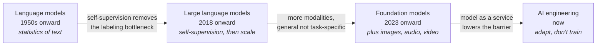
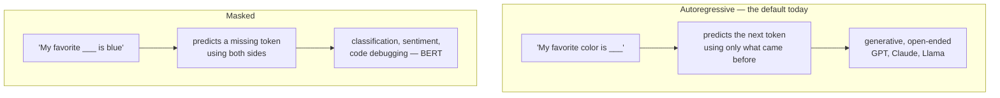
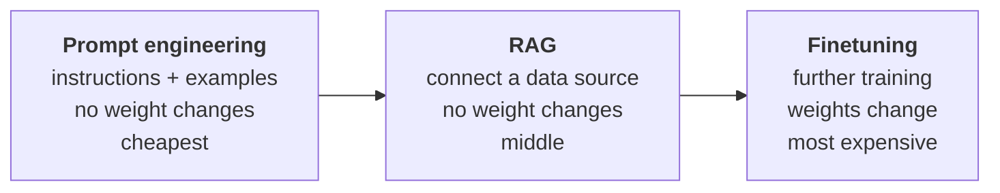
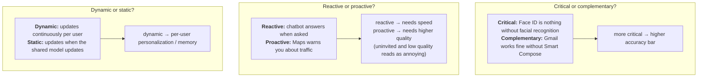
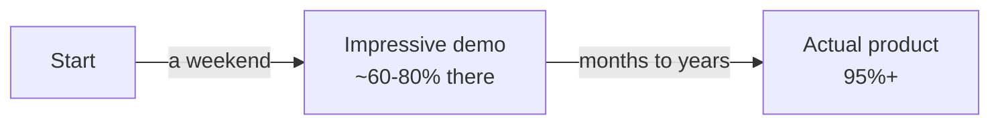
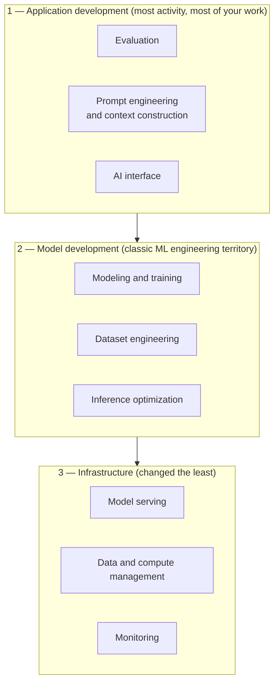
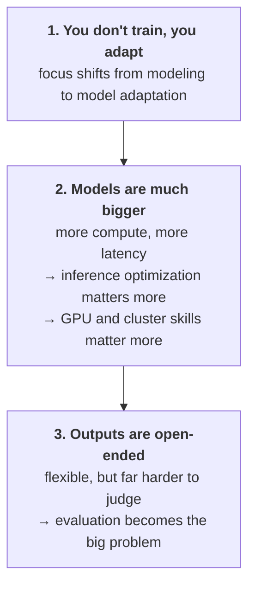
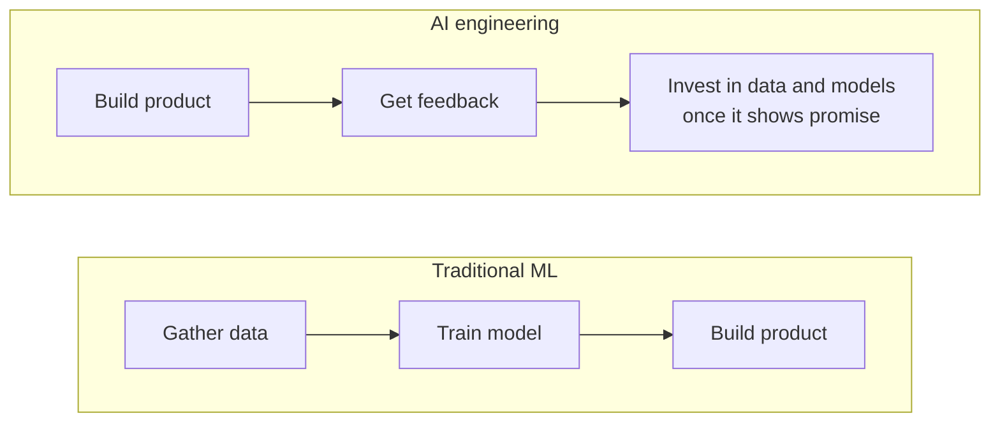

# Chapter 1: Introduction to Building AI Applications with Foundation Models

> **The framing chapter.** Where AI engineering came from, what it actually is (adapting models you did not train), which application patterns work, and how to decide whether to build at all.

`~12 min read` · `book pages 1-47` · `maps to: milestone 0 + artifact 1`

---

## Skim this first

| # | Section | The one thing to take away |
|:--|:--|:--|
| [1](#1-the-thesis-in-one-paragraph) | The thesis | Demand up, barrier down. That gap is AI engineering |
| [2](#2-how-we-got-here) | How we got here | Three transitions, each with one specific unlock |
| [3](#3-language-models-tokens-and-completion) | LMs, tokens, completion | A model is a completion machine. Most tasks reframe as completion |
| [4](#4-self-supervision-the-unlock) | Self-supervision | Labels come free from the text. This is what allowed scale |
| [5](#5-foundation-models-and-adaptation) | Foundation models | Adapt one general model instead of training many specific ones |
| [6](#6-the-eight-use-case-patterns) | Eight use cases | `mind` is *data organization* + *information aggregation* |
| [7](#7-planning-should-you-build-it-at-all) | Should you build it? | Critical/reactive/dynamic axes, Crawl-Walk-Run, defensibility |
| [8](#8-setting-expectations-and-the-last-mile) | Expectations, last mile | 0 to 60 is a weekend. 60 to 100 is months |
| [9](#9-maintenance-riding-the-bullet-train) | Maintenance | The best option today is the worst option tomorrow |
| [10](#10-the-three-layer-ai-stack) | Three-layer stack | Start at the top layer, go down only as needed |
| [11](#11-ai-engineering-vs-ml-engineering) | AI eng vs ML eng | Open-ended output makes **evaluation** the hard problem |
| [12](#12-ai-engineering-vs-full-stack) | AI eng vs full-stack | The workflow inverted: product first, data and models later |
| [13](#13-what-chapter-1-means-for-mind) | What it means for `mind` | The decisions this chapter settles, and the spec to write |
| [14](#14-chapter-1-in-ten-lines) | Ten-line recap | The whole chapter, compressed |

> [!TIP]
> Boxes like this one appear throughout and connect the concept back to **`mind`**. If you are skimming for practical impact, read only those.

---

## 1. The thesis in one paragraph

Scaling models had two consequences that point in opposite directions, and the gap between them is where this whole discipline lives.

1. **Models got more capable**, so demand for AI applications went **up**.
2. **Training them got so expensive** that only a handful of orgs can, so those orgs sell access, and the barrier to *building on top* went **down**.

Demand up, barrier down. That gap is AI engineering: **building applications on top of models someone else trained**.

The one-line distinction to hold onto for the rest of the book:

> **ML engineering develops models. AI engineering adapts them.**

Chip is explicit that this is not a brand-new field. It grew out of ML engineering, and most of the operational discipline (systematic experimentation, rigorous evaluation, latency and cost optimization, feedback loops) carries over unchanged. What is new is that you start from a capable general model instead of a blank one, and that the outputs are open-ended, which makes evaluation much harder.

> [!TIP]
> **In `mind`:** this is why the plan never involves training a model. You are hosting open weights and adapting them. Hosting your own is a **sovereignty** decision, not a modeling one, and it is worth being precise about that when you write the posts.

---

## 2. How we got here



Three transitions, each caused by one specific unlock:

| Transition | The unlock | Why it mattered |
|:--|:--|:--|
| LM → LLM | **Self-supervision** | Training data stopped needing human labels, so datasets could scale |
| LLM → FM | **More modalities** | Models stopped being divided by data type (NLP vs vision vs audio) |
| FM → AI engineering | **Model as a service** | You get a powerful model from one API call, no infra required |

The word *foundation* is doing real work. It signals both that these models are central to applications and that they are meant to be **built upon**.

---

## 3. Language models, tokens, and completion

### 3.1 Tokens

The basic unit is the **token**: a character, a word, or a word fragment like `-tion`. Breaking text into tokens is **tokenization**. The full set a model knows is its **vocabulary**.

| Model | Vocabulary size |
|:--|--:|
| GPT-4 | 100,256 |
| Mixtral 8x7B | 32,000 |

**Rough conversion: 100 tokens ≈ 75 words** (a token is about ¾ of a word).

Why tokens instead of words or characters?

1. Tokens preserve meaningful sub-parts (`cooking` → `cook` + `ing`).
2. Fewer unique tokens than unique words, so a smaller vocabulary and a more efficient model.
3. Unknown words still work (`chatgpting` → `chatgpt` + `ing`).

Tokens sit between characters and words: fewer units than words, more meaning than characters.

### 3.2 Two kinds of language model



Unless a book says otherwise, "language model" means **autoregressive**. Those are the ones that generate.

### 3.3 The completion machine

A language model is a **completion machine**. Give it text, it tries to continue it. That sounds trivial and is not, because a huge number of tasks reframe as completion:

```text
Prompt:      "How are you in French is"
Completion:  "Comment ça va"                    →  translation

Prompt:      "Is this email likely spam? <email> Answer:"
Completion:  "Likely spam"                      →  classification
```

Two things to keep in mind:

> [!IMPORTANT]
> **Completions are predictions, not facts.** They are probabilistic. This is the source of both the magic and the hallucinations (chapter 2 goes deeper).
>
> **Completion is not conversation.** Ask a raw completion model a question and it might continue with *another question* rather than answer it. Making models respond helpfully takes post-training, covered in chapter 2.

> [!TIP]
> **In `mind`:** your model gateway is a completion API, and every feature you build (summarizing a day, extracting topics, connecting old notes to a new idea) is you reframing a task as completion. Worth writing the reframing down explicitly for each feature in the spec.

---

## 4. Self-supervision: the unlock

This is the single most important mechanism in the chapter.

**Supervision** needs labeled data. Humans label examples, the model learns from them. Expensive and slow.

> [!WARNING]
> **ImageNet math:** 5 cents per image × 1M images = **$50,000**. Want two labelers for quality? Double it. Want 1M categories instead of 1,000? **$50 million** in labeling alone.
>
> And that is for easy labels. Latin translations cost more. "Does this CT scan show cancer" is astronomical.

**Self-supervision** removes the bottleneck: labels are inferred from the input itself. In language modeling, every sequence is simultaneously the input and the answer key.

The sentence `"I love street food."` produces six training samples for free:

| Input (context) | Output (next token) |
|:--|:--|
| `<BOS>` | I |
| `<BOS>, I` | love |
| `<BOS>, I, love` | street |
| `<BOS>, I, love, street` | food |
| `<BOS>, I, love, street, food` | . |
| `<BOS>, I, love, street, food, .` | `<EOS>` |

Text is everywhere (books, blogs, articles, comments), so training data became effectively unlimited, and models could scale into the billions of parameters.

> [!NOTE]
> **Self-supervised is not unsupervised.** Self-supervised infers labels from the data. Unsupervised needs no labels at all.

**On size:** *parameters* are the variables updated during training. More parameters means more capacity to learn, which is why bigger models need more data (you are maximizing performance, not matching a small model's).

| Model | Year | Parameters | Considered |
|:--|:--|--:|:--|
| GPT-1 | 2018 | 117M | large |
| GPT-2 | 2019 | 1.5B | made 117M look small |
| today's frontier | 2024+ | ~100B+ | large |

The word "large" is not scientific. What is large today is tiny tomorrow.

> [!TIP]
> **In `mind`:** your corpus is raw unlabeled text from your own screen, exactly the kind of data self-supervision thrives on. But note the asymmetry: this is what makes **pre-training** cheap, not what makes **your evaluation** cheap. Chapters 3 and 4 will make you hand-label ~50 questions, and there is no self-supervised shortcut around that. Labeling is still the expensive part of your project.

---

## 5. Foundation models and adaptation

Foundation models are the shift from **task-specific** to **general-purpose**. Before, a sentiment model could not translate. Now one model does both, decently, out of the box. You then tweak it to be good at your specific thing.

Three adaptation techniques, in increasing order of effort:



The clean split:

| | Prompt-based (prompting, RAG) | Finetuning |
|:--|:--|:--|
| Model weights | Unchanged | Updated |
| Data needed | Little | More |
| Complexity | Low | High |
| Good for | Most things | New tasks, strict latency/cost/quality targets |

**The economics:** adapting an existing model is roughly *ten examples and one weekend* versus *1M examples and six months* to build from scratch.

> [!TIP]
> **In `mind`:** this is the exact ordering of your artifacts. Prompting in chapter 5, RAG in chapter 6, finetuning in chapters 7 and 8. Doing them in that order is not arbitrary sequencing, it is the actual recommended methodology. Your artifact 4 result (LoRA probably loses to prompting) is this principle showing up as data.

---

## 6. The eight use case patterns

Chip categorized both enterprise interviews (50 companies) and consumer apps (205 open source repos with 500+ stars) into eight buckets:

| Category | Consumer | Enterprise |
|:--|:--|:--|
| **Coding** | Coding | Coding |
| **Image / video** | Photo and video editing | Design, presentations, ad generation |
| **Writing** | Email, social posts | Copywriting, SEO, reports, memos |
| **Education** | Tutoring, essay grading | Onboarding, upskilling |
| **Conversational bots** | General chatbot, companion | Customer support, product copilots |
| **Information aggregation** | Summarization, talk-to-your-docs | Summarization, market research |
| **Data organization** | Image search, **memex** | Knowledge management, doc processing |
| **Workflow automation** | Travel and event planning | Data extraction, entry, lead gen |

Coding is the most popular use case in every survey, partly because AI is good at it and partly because early AI engineers were coders scratching their own itch.

Two useful patterns from the data:

- **Enterprises deploy internal-facing apps before external-facing ones.** Internal knowledge management ships before customer support bots, because it builds expertise while limiting privacy, compliance, and blow-up risk.
- **Many apps built on open-ended models are still close-ended** (classification and similar), because close-ended tasks are easier to evaluate, which makes the risk easier to estimate.

> [!TIP]
> **In `mind`:** your project sits squarely in two rows, **data organization** (the book literally lists *memex* as the consumer example) and **information aggregation**. That is a real, surveyed, industry-proven category, not a thing you invented.
>
> The internal-first pattern also applies to you personally: `mind` is an internal tool with an audience of one, which is exactly the low-risk place to build expertise.

---

## 7. Planning: should you build it at all?

> It's easy to build a cool demo with foundation models. It's hard to create a profitable product.

> [!NOTE]
> Chip's caveat first: if you are building to learn and have fun, **skip this section and go build**. Building is one of the best ways to learn, and several heads of AI told her they push their teams to experiment purely to upskill. The framework below is for when it is your livelihood.

### 7.1 Three levels of motivation

| Level | Motivation | Who |
|:--|:--|:--|
| **1. Existential** | Competitors with AI make you obsolete | 7% of Gartner's 2,500 execs cited business continuity |
| **2. Opportunity** | Boost profit and productivity | Where most companies sit |
| **3. FOMO** | Unsure where it fits, but do not want to be Kodak | Legitimate as R&D if you can afford it |

If AI is existential to you, build in-house rather than handing it to a competitor. If it is opportunity, buying is often better.

### 7.2 Three axes for AI's role in the product



### 7.3 Human in the loop: Crawl-Walk-Run

Microsoft's framework for ramping automation:

| Stage | Meaning |
|:--|:--|
| 🐛 **Crawl** | Human involvement mandatory |
| 🚶 **Walk** | AI interacts directly with internal employees |
| 🏃 **Run** | Increased automation, potentially direct contact with external users |

The role of humans shifts as quality proves out. Start by having AI draft suggestions for a human. If 95% of suggestions get used verbatim, let it handle those cases directly.

### 7.4 Defensibility

The low barrier is a blessing and a curse. If it was easy for you, it is easy for a competitor.

> [!CAUTION]
> **Model subsumption.** You build a layer on top of a model. The model gets better, absorbs your layer, and you are obsolete. Building a PDF parser on the assumption that ChatGPT parses PDFs badly is a bet that ChatGPT stays bad.
>
> **Big-company replication.** A VC told Chip she sees startups whose entire product could be a Google Docs feature. If it takes off, what stops Google assigning three engineers for two weeks?

Three competitive advantages exist:

| Advantage | Who wins it with foundation models |
|:--|:--|
| Technology | Nobody. It converges |
| Distribution | Incumbents |
| **Data** | **The one you can actually win**, if you get to market and gather usage data |

The counterexamples are encouraging. Calendly could have been a Google Calendar feature. Mailchimp could have been Gmail. Photoroom could have been Google Photos.

> [!TIP]
> **In `mind`:** run the three axes on your own project before writing the spec.
>
> - **Complementary**, not critical. If retrieval returns nothing useful, you still have your notes. That means a lower accuracy bar early, which is permission to ship artifact 1 rough.
> - **Both reactive and proactive.** *"What did I think about X"* is reactive and needs to feel fast. *"Here are three ideas you have been circling"* is proactive, can be precomputed overnight, and carries a **higher quality bar** because you did not ask for it. Real design constraint: ship the reactive half first.
> - **Dynamic.** Per-user by definition, since the user is you and the corpus grows daily.
>
> On defensibility, the subsumption risk is real (ChatGPT and Claude both ship memory features now). Your moats are the two Chip names as winnable: **your own data**, which nobody else has, and **self-hosting**. Chip makes this point herself: a PDF parser still makes sense *"if it's built on top of open source models, gearing your solution toward users who want to host models in-house."* That is your positioning, stated in the book.

---

## 8. Setting expectations and the last mile

### 8.1 Usefulness threshold

Before building, define **how good it has to be to be useful**.

| Group | Examples |
|:--|:--|
| **Quality** | Is the response good (chapters 3 and 4) |
| **Latency** | TTFT (time to first token), TPOT (time per output token), total latency |
| **Cost** | Cost per inference request |
| **Other** | Interpretability, fairness |

Latency is relative to the alternative. If humans currently respond in a median of an hour, anything faster might be good enough.

### 8.2 Milestone planning starts with evaluating what already exists

Evaluate off-the-shelf models **first**. The stronger they are, the less you build. If your goal is automating 60% of tickets and a stock model already does 30%, that is a very different project than starting from zero.

And be willing to kill it: after evaluation you may find the effort to reach the usefulness threshold exceeds the return.

### 8.3 The last mile problem

This is the most important practical warning in the chapter.



> [!WARNING]
> **Two data points on the last mile:**
>
> **UltraChat** (Ding et al., 2023): *"the journey from 0 to 60 is easy, whereas progressing from 60 to 100 becomes exceedingly challenging."*
>
> **LinkedIn** (2024): one month to reach 80% of the experience they wanted. Then **four more months** to pass 95%. Most of it spent on product kinks and hallucinations, with each additional 1% arriving slowly enough to be demoralizing.

> [!TIP]
> **In `mind`:** this is the argument for your five-artifact structure. A single three-month repo would hit the demo high in week two and then grind through the last mile with nothing to show. Five separate finished things means you ship at the top of each curve rather than stalling on one.
>
> It is also why artifact 1 is a **data pipeline** and not a chatbot demo. Pipelines actually finish.

---

## 9. Maintenance: riding the bullet train

Building on foundation models means committing to a fast-moving base.

| Change type | Example | Difficulty |
|:--|:--|:--|
| Good but disruptive | Costs drop, context windows grow, quality improves | Forces constant re-evaluation of past decisions |
| Provider churn | You build in-house to save money, providers halve prices three months later | Medium |
| Model swaps | APIs are converging, but each model has quirks that break your prompts | Medium, needs versioning and eval infra |
| Regulatory | GDPR compliance was estimated at $9B across businesses. Export controls can cut off GPU supply overnight | Hard |
| Existential | IP law around models trained on other people's data is unsettled | Potentially fatal |

The recurring lesson: **the best option today can be the worst option tomorrow**, so keep running the cost-benefit analysis.

> [!TIP]
> **In `mind`:** the defense is the ingestion contract you already wrote. `{source, timestamp, text, meta}` means swapping Screenpipe, or the model, or the serving stack touches one adapter and nothing else.
>
> Chip's specific note that *"without proper infrastructure for versioning and evaluation in place, the process can cause a lot of headaches"* is the argument for building artifact 2 (the eval harness) before you start swapping models around.

---

## 10. The three-layer AI stack



You start at the **top** and move down only as needed. That ordering is the whole methodology.

**Evidence:** Chip's March 2024 survey of 920 AI GitHub repos with 500+ stars found that after ChatGPT, applications and application development exploded, while infrastructure grew only modestly. Expected, since serving, resource management, and monitoring needs did not fundamentally change.

Which leads to the reassuring point: a lot of ML engineering wisdom still applies. You still map business metrics to model metrics. You still run systematic experiments (now over models, prompts, retrieval algorithms, and sampling variables instead of hyperparameters). You still optimize for speed and cost. You still close the feedback loop with production data.

> [!TIP]
> **In `mind`:** your repo maps onto these three layers cleanly, and the directory structure should say so.
>
> | Layer | In `mind` | Chapters |
> |:--|:--|:--|
> | Application | `evals/`, prompt layer, retrieval, chat harness | 3, 4, 5, 6, 10 |
> | Model | `mind/ingest/` and corpus work, the LoRA experiment | 7, 8 |
> | Infrastructure | `serve/` (Ollama now, vLLM later) | 2, 9 |
>
> You are starting at the top layer and moving down, exactly as prescribed. Ollama now and vLLM at chapter 9 is you deferring infrastructure until it is actually the constraint.

---

## 11. AI engineering vs ML engineering

Three differences, and they cascade:



**Model development**

| Category | Traditional ML | Foundation models |
|:--|:--|:--|
| Modeling and training | ML knowledge required | ML knowledge nice-to-have |
| Dataset engineering | Feature engineering, tabular data | Dedup, tokenization, context retrieval, quality control |
| Inference optimization | Important | Even more important |

**Application development**

| Category | Traditional ML | Foundation models |
|:--|:--|:--|
| AI interface | Less important | Important |
| Prompt engineering | Not applicable | Important |
| Evaluation | Important | **More important** |

### 11.1 Why evaluation gets so much harder

In close-ended tasks like fraud detection there is a ground truth. Output differs from expected, model is wrong, done.

For open-ended tasks there are too many acceptable responses to enumerate. And adaptation technique choice muddies it further: a system that looks bad under one technique can look good under another.

> [!IMPORTANT]
> **The Gemini benchmark story.** Google claimed Gemini beat GPT-4 on MMLU. But they evaluated Gemini with CoT@32 (32 examples) against GPT-4 with 5 examples. Matched fairly at 5 examples each, **GPT-4 won**.
>
> Prompting technique alone moved Gemini Ultra from **83.7% to 90.04%**. Same model, different prompt, opposite conclusion.

### 11.2 Terminology worth getting right

| Term | Means |
|:--|:--|
| **Pre-training** | Training from scratch, random initial weights. ~98% of InstructGPT's total compute |
| **Finetuning** | Continuing to train an already-trained model |
| **Post-training** | Same as finetuning, but done by the model developer before release |
| **Not training** | Prompt engineering. Feeding examples into context is **not** training |

Quantization changes weight *values* but is not training either.

Chip calls out a Business Insider writer who said she "trained" ChatGPT on her childhood journals. Colloquially fine. Technically that is prompt engineering.

> [!TIP]
> **In `mind`:** two things here.
>
> The Gemini story is the argument for artifact 2 in one anecdote, and worth quoting directly in that post. If prompting technique alone can flip a benchmark, any comparison without a **fixed** eval set is meaningless. Your 50 hand-labeled questions are the fixed thing. Keyword search versus embeddings only means something because the questions did not change between runs.
>
> The childhood-journals example is almost exactly your project, so get the vocabulary right in your posts. Feeding your corpus into context is prompt engineering or RAG. Only artifact 4 involves actual training.

---

## 12. AI engineering vs full-stack

The emphasis on interfaces pulls AI engineering toward full-stack. ML tooling used to be Python-only. Now there is LangChain.js, Transformers.js, OpenAI's Node library, and Vercel's AI SDK.

The deeper change is that **the workflow inverted**:



The new order rewards whoever can iterate fastest, which is why full-stack engineers do well here. Model development and product development used to be disjoint, with ML engineers rarely in product decisions. Now AI engineers are deep in the product.

> [!TIP]
> **In `mind`:** this justifies your whole artifact ordering. You are building the product (pipeline, then retrieval) before investing in data curation and finetuning, which arrive in chapters 7 and 8. Done the traditional-ML way, you would be curating a training set right now instead of having something that runs.

---

## 13. What chapter 1 means for `mind`

### 13.1 Decisions this chapter settles

| Decision | Chapter 1 basis |
|:--|:--|
| Do not train a model, adapt one | AI engineering is adaptation by definition |
| Prompt → RAG → finetune, in that order | Cost and complexity ordering of adaptation techniques |
| Build the product before curating data | The inverted AI engineering workflow |
| Start at the application layer, defer infra | Three-layer stack, top-down |
| Evaluation is the hard part, not the model | Open-ended outputs, plus the Gemini benchmark story |
| Ship five artifacts, not one repo | The last mile problem |
| Self-hosting is the positioning | Chip's note about serving users who want in-house hosting |

### 13.2 The spec chapter 1 says to write

Chip's planning framework maps to five questions. Answer these in `book/spec.md` before starting artifact 1.

- [ ] **Why build it?** Learning is a legitimate answer, and Chip says so explicitly. Say it plainly rather than inventing a business case.
- [ ] **What role does AI play?** Complementary, both reactive and proactive, dynamic. Reactive ships first, since the proactive half carries a higher quality bar.
- [ ] **What is the usefulness threshold?** Pick a number now, before you can measure it. Something like: *for 7 of 10 real questions about my own past, the answer beats grepping my notes.*
- [ ] **What are the three example queries?** Write the actual sentences. They seed your 50-question eval set in chapter 3.
- [ ] **What is the last-mile risk?** Name the part you expect to grind on. Probably noise filtering, given that 661 of your first 687 frames are Chrome.

### 13.3 Open questions this chapter raises but does not answer

| Question | Answered in |
|:--|:--|
| What sampling settings should the gateway default to? | Chapter 2 |
| How do you score an open-ended answer with no ground truth? | Chapters 3 and 4 |
| How much context can you afford per query? | Chapters 5 and 6 |

---

## 14. Chapter 1 in ten lines

1. Demand for AI apps went up while the barrier to building them went down. That gap is AI engineering.
2. ML engineering **develops** models. AI engineering **adapts** them.
3. Self-supervision removed the labeling bottleneck, which is what allowed models to scale.
4. A language model is a completion machine. Most tasks can be reframed as completion.
5. Foundation models are general-purpose, so you adapt one model rather than train many task-specific ones.
6. Three adaptation techniques by cost: **prompting → RAG → finetuning**. Use them in that order.
7. The stack has three layers: application, model, infrastructure. Start at the top, go down only as needed.
8. Open-ended outputs make **evaluation** the defining hard problem of AI engineering.
9. The last mile is brutal. 0 to 60 takes a weekend. 60 to 100 takes months.
10. The workflow inverted: build the product first, invest in data and models once it shows promise.

---

<div align="center">

**Next:** Chapter 2, Understanding Foundation Models
*Training data, architecture, post-training, and sampling. The chapter that makes your model gateway make sense.*

</div>
